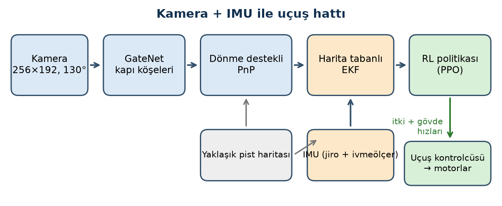
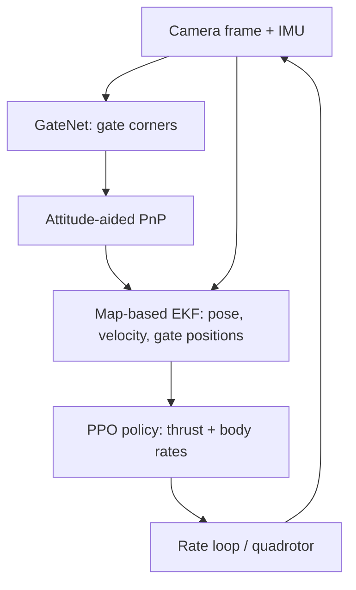
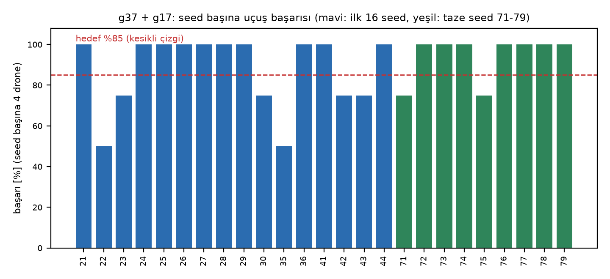
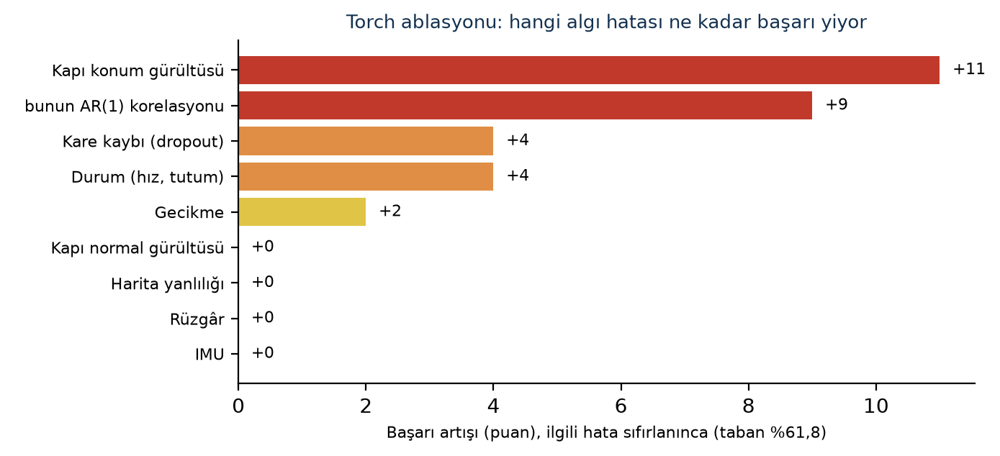
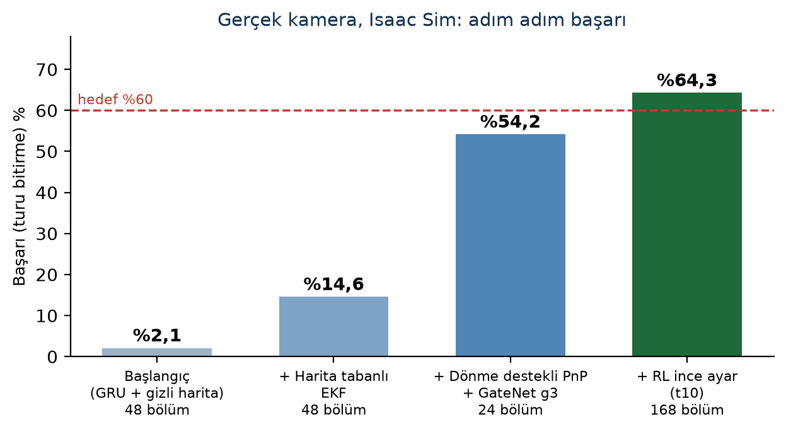

🇬🇧 English · 🇹🇷 [Türkçe](README.tr.md)

# DroneRacing

**Camera + IMU gate-racing drone flown by an RL policy: 86.5 % success at 20.55 m/s mean speed in Isaac simulation.**

A learned gate detector (GateNet), a map-based EKF and a state-based PPO policy (collective thrust + body rates) race an A2RL-type quadrotor through gates using only a camera and an IMU. The goal is sim2real transfer; hardware tests are still open.



*Perception-to-control pipeline (GateNet → PnP → EKF → policy).*

## Summary

| Problem | Method | Simulation / hardware | Paper |
|---|---|---|---|
| High-speed gate racing from camera + IMU only | GateNet detector, attitude-aided PnP, map-based EKF, PPO policy, weight-soup of a safe and a fast policy | Isaac Lab (camera line); Jetson Orin NX + IMX219 planned (`jetson/`) | [paper/droneracing-camera-flight.pdf](paper/droneracing-camera-flight.pdf) (Turkish) |

### System architecture


GateNet finds gate corners in the image, PnP with IMU attitude gives gate poses, the EKF fuses them with a gate map, and the policy outputs thrust and body rates.

### Flow diagram (how it works)



## Selected results

### Result 1: final fast model (soup85), per seed
soup85 = 0.15 × g37 (safe) + 0.85 × g38d (fast). Pooled over 24 seeds, 96 flights: 83/96 = 86.5 % success (95 % CI 78.2–91.9) at 20.55 m/s true mean speed (Isaac).



### Result 2: perception ablation
Success rate with different perception components removed or replaced by ground truth; perception is the bottleneck.



### Result 3: progress over model versions


*All figures are in `plots/`. Datasets and checkpoints are not in this repository.*

## Installation

Requirements: Linux, Python ≥ 3.10, NVIDIA GPU. Isaac evaluation needs Isaac Lab in docker (`scripts/run_isaaclab.sh`).

```bash
git clone https://github.com/GulogluHaktan/DroneRacing.git
cd DroneRacing
python -m venv .venv && source .venv/bin/activate
pip install -r requirements.txt
python scripts/check_install.py
```

## Usage

Model weights are **not** in the repository (see `releases/*/MANIFEST.md` for the recipe and the exact files). With weights in place, evaluate a policy in Isaac:

```bash
scripts/run_isaaclab.sh isaac/eval_vision.py --policy runs/<policy> \
  --gatenet runs_host/<gatenet>/gatenet.pt --estimator runs_host/<est>/estimator.pt \
  --n-envs 24 --steps 3000 --ekf --seed 21
```

Expected output: per-seed success rate and true mean speed (`VISION` line). The GPU must be free of trainers.

## Reproducing the results

| Figure | Command |
|---|---|
| Result 1 | `python scripts/make_report_g37.py` (needs `runs/` logs) |
| Result 2 | `python scripts/make_perception_report.py` |
| Result 3 | `python report/charts.py` |

Training recipes: `releases/v3_FAST_soup85_nov5/recipe/`. Soup: `scripts/make_soup.py`.

## Project structure

```
DroneRacing/
├── assets/        # README images
├── docs/          # phase specs
├── droneracing/   # core: env, quad, GateNet, EKF variants, PPO
├── isaac/         # Isaac Lab camera rig, evaluation, data collection
├── jetson/        # Jetson Orin NX camera / IMU / ONNX tools
├── paper/         # report PDF
├── plots/         # result figures
├── releases/      # manifests, recipes, eval logs (no weights)
├── report/ reports/  # report builders and PDFs
├── scripts/       # training, evaluation, diagnostics
├── tests/
└── requirements.txt
```

## Citation, license, contact

```bibtex
@misc{droneracing2026,
  title  = {DroneRacing: camera and IMU gate racing with an RL policy},
  author = {Gulogluhaktan},
  year   = {2026},
  url    = {https://github.com/GulogluHaktan/DroneRacing}
}
```

License: TODO (not chosen yet). Contact: via GitHub (GulogluHaktan).
