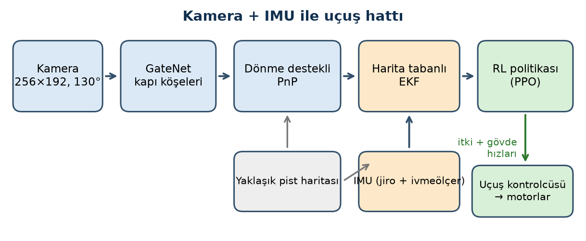
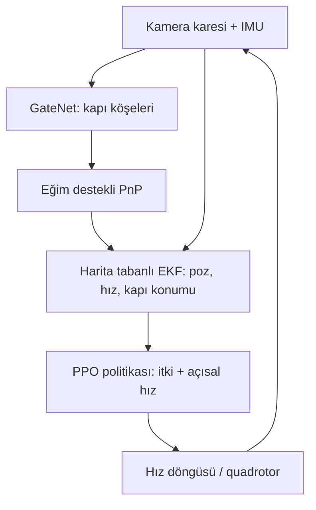
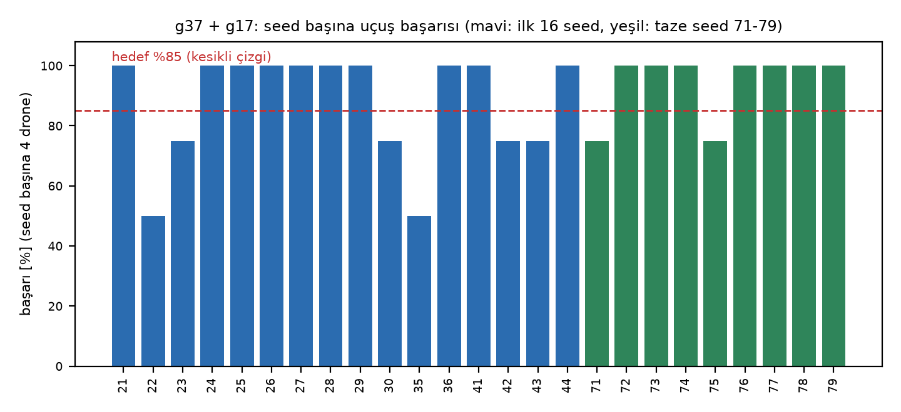
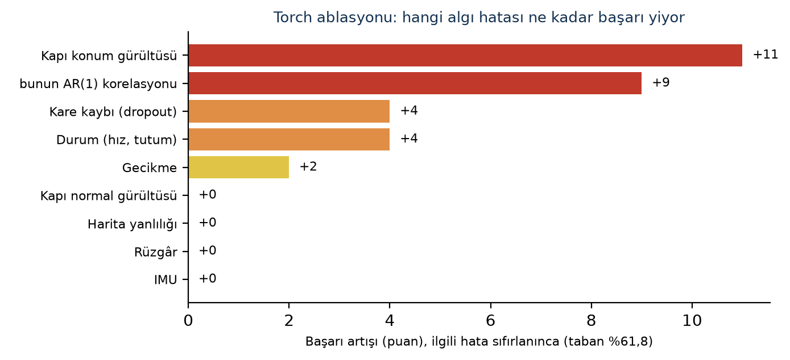
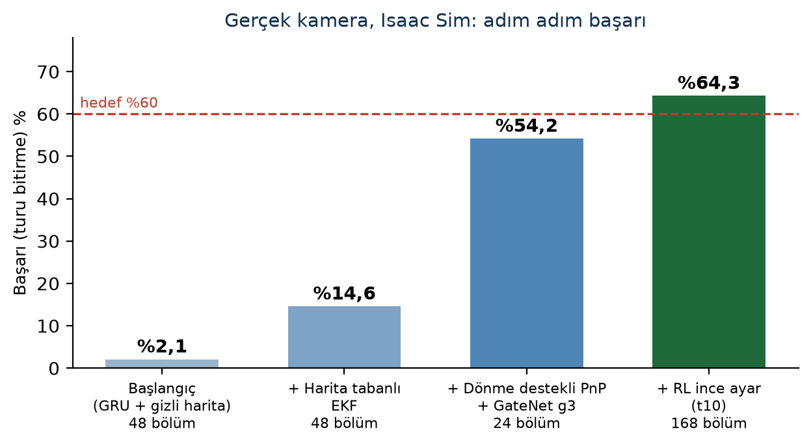

🇬🇧 [English](README.md) · 🇹🇷 Türkçe

# DroneRacing

**Kamera + IMU ile kapı yarışı yapan, RL politikasıyla uçan drone: Isaac simülasyonunda %86,5 başarı, 20,55 m/s ortalama hız.**

Öğrenilmiş kapı dedektörü (GateNet), harita tabanlı EKF ve durum tabanlı PPO politikası (toplam itki + gövde açısal hızları), A2RL tipi bir quadrotoru yalnızca kamera ve IMU ile kapılardan geçirir. Amaç sim2real aktarımıdır; donanım testleri henüz yapılmadı.



*Algıdan kontrole hat (GateNet → PnP → EKF → politika).*

## Özet

| Problem | Yöntem | Simülasyon / donanım | Makale |
|---|---|---|---|
| Yalnızca kamera + IMU ile yüksek hızlı kapı yarışı | GateNet dedektörü, eğim destekli PnP, harita tabanlı EKF, PPO politikası, güvenli ve hızlı politikanın ağırlık karışımı | Isaac Lab (kamera hattı); Jetson Orin NX + IMX219 planlı (`jetson/`) | [paper/droneracing-camera-flight.pdf](paper/droneracing-camera-flight.pdf) |

### Sistem mimarisi


GateNet görüntüde kapı köşelerini bulur, IMU eğimli PnP kapı pozunu verir, EKF bunları kapı haritasıyla birleştirir, politika itki ve açısal hız üretir.

### Akış şeması (nasıl çalışır)



## Seçilmiş sonuçlar

### Sonuç 1: nihai hızlı model (soup85), tohum bazında
soup85 = 0,15 × g37 (güvenli) + 0,85 × g38d (hızlı). 24 tohum, 96 uçuş: 83/96 = %86,5 başarı (%95 GA 78,2–91,9), 20,55 m/s gerçek ortalama hız (Isaac).



### Sonuç 2: algı ablasyonu
Algı bileşenleri çıkarıldığında veya gerçek değerle değiştirildiğinde başarı oranı; darboğaz algıdır.



### Sonuç 3: model sürümleri boyunca ilerleme


*Tüm şekiller `plots/` klasöründe. Veri setleri ve checkpoint'ler bu repoda yoktur.*

## Kurulum

Gereksinimler: Linux, Python ≥ 3.10, NVIDIA GPU. Isaac değerlendirmesi docker içinde Isaac Lab ister (`scripts/run_isaaclab.sh`).

```bash
git clone https://github.com/GulogluHaktan/DroneRacing.git
cd DroneRacing
python -m venv .venv && source .venv/bin/activate
pip install -r requirements.txt
python scripts/check_install.py
```

## Kullanım

Model ağırlıkları repoda **yoktur** (tarif ve dosya listesi için `releases/*/MANIFEST.md`). Ağırlıklar yerindeyse Isaac'te politika değerlendirme:

```bash
scripts/run_isaaclab.sh isaac/eval_vision.py --policy runs/<policy> \
  --gatenet runs_host/<gatenet>/gatenet.pt --estimator runs_host/<est>/estimator.pt \
  --n-envs 24 --steps 3000 --ekf --seed 21
```

Beklenen çıktı: tohum başına başarı oranı ve gerçek ortalama hız (`VISION` satırı). GPU'da eğitim çalışmamalıdır.

## Sonuçları yeniden üret

| Şekil | Komut |
|---|---|
| Sonuç 1 | `python scripts/make_report_g37.py` (`runs/` logları gerekir) |
| Sonuç 2 | `python scripts/make_perception_report.py` |
| Sonuç 3 | `python report/charts.py` |

Eğitim tarifleri: `releases/v3_FAST_soup85_nov5/recipe/`. Ağırlık karışımı: `scripts/make_soup.py`.

## Proje yapısı

```
DroneRacing/
├── assets/        # README görselleri
├── docs/          # faz şartnameleri
├── droneracing/   # çekirdek: env, quad, GateNet, EKF varyantları, PPO
├── isaac/         # Isaac Lab kamera düzeneği, değerlendirme, veri toplama
├── jetson/        # Jetson Orin NX kamera / IMU / ONNX araçları
├── paper/         # rapor PDF
├── plots/         # sonuç grafikleri
├── releases/      # manifest, tarif, değerlendirme logları (ağırlık yok)
├── report/ reports/  # rapor üreticileri ve PDF'ler
├── scripts/       # eğitim, değerlendirme, tanı
├── tests/
└── requirements.txt
```

## Atıf, lisans, iletişim

```bibtex
@misc{droneracing2026,
  title  = {DroneRacing: camera and IMU gate racing with an RL policy},
  author = {Gulogluhaktan},
  year   = {2026},
  url    = {https://github.com/GulogluHaktan/DroneRacing}
}
```

Lisans: TODO (henüz seçilmedi). İletişim: GitHub (GulogluHaktan).
